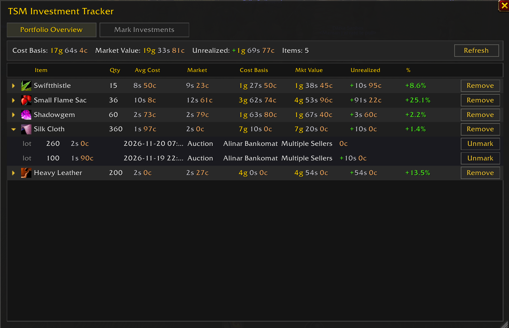

# TSM Investment Tracker

WoW: Forever addon that marks TradeSkillMaster Accounting purchases as **investments** and shows a stock-style **Portfolio Overview**.

## Requirements

- **WoW: Forever** (Interface `16001`)
- [TradeSkillMaster](https://www.tradeskillmaster.com/) Forever build (with Accounting purchase history)
- TSM Desktop App for AuctionDB market prices (`DBMarket`)

## Install (Forever)

1. Run `sync-to-forever.ps1` (copies the addon and installs the TSM Accounting bridge), **or** install from a CurseForge/release zip and follow `TSMBridge\INSTALL.txt`.
2. `/reload`.
3. Confirm **TSM Investment Tracker** and TSM are enabled.
4. `/tsminv`

## CurseForge

1. Follow **[CURSEFORGE.md](CURSEFORGE.md)** to create the project and upload.
2. Build the zip: `.\package-release.ps1` → `dist\TSMInvestmentTracker-<version>.zip`
3. Set `## X-Curse-Project-ID` in the `.toc` after CurseForge assigns an ID (replace `0`).

**Note:** CurseForge targets official WoW clients in its version picker. This addon is built for **Forever** (`16001`). Call that out in the project description. The optional TSM bridge is not auto-installed by the CurseForge client — see bridge notes below.

## Usage

### Mark Investments

1. Open `/tsminv` → **Mark Investments**.
2. Browse purchases from TSM Accounting (same data as the Ledger).
3. Click **Mark** on buys you want to track as investments.
4. Use search / “Hide already marked” to filter. **Unmark** removes a lot.
5. **Refresh** flushes TSM Accounting into saved `csvBuys` (same as logout/`/reload`), then reloads the list — requires the TSM bridge.

Marked quantity is the portfolio position — bags/bank/AH are ignored. Marks are **account-wide**.

### Portfolio Overview

| Column | Meaning |
| --- | --- |
| Qty | Sum of marked lot quantities |
| Avg Cost | Weighted average buy price of marked lots |
| Market | TSM Market Value (`DBMarket`) |
| Cost Basis | Qty × prices of marked lots |
| Mkt Value | Market × qty |
| Unrealized | Market value − cost basis |
| % | Unrealized / cost basis |

Click a row’s caret to expand individual lots. **Remove** clears all lots for that item.

## Slash commands

- `/tsminv` — toggle the window
- `/tsminvestment` — same
- `/tsminv help` — help
- `/tsminv debug` — data probe

## TSM bridge

`TSMIT_TSMBridge.lua` must load inside TradeSkillMaster so **Refresh** can flush live Accounting the same way `/reload` does.

- Forever helper: `sync-to-forever.ps1`
- Manual: `TSMInvestmentTracker\TSMBridge\INSTALL.txt`

Without the bridge, Mark Investments still shows last-saved Accounting data.

## Notes

- Selling in-game does **not** auto-reduce lots; unmark or Remove when you close a position.
- TSM updates can remove the bridge toc line — re-run sync or re-add it.

## License

MIT — see [LICENSE](LICENSE).
